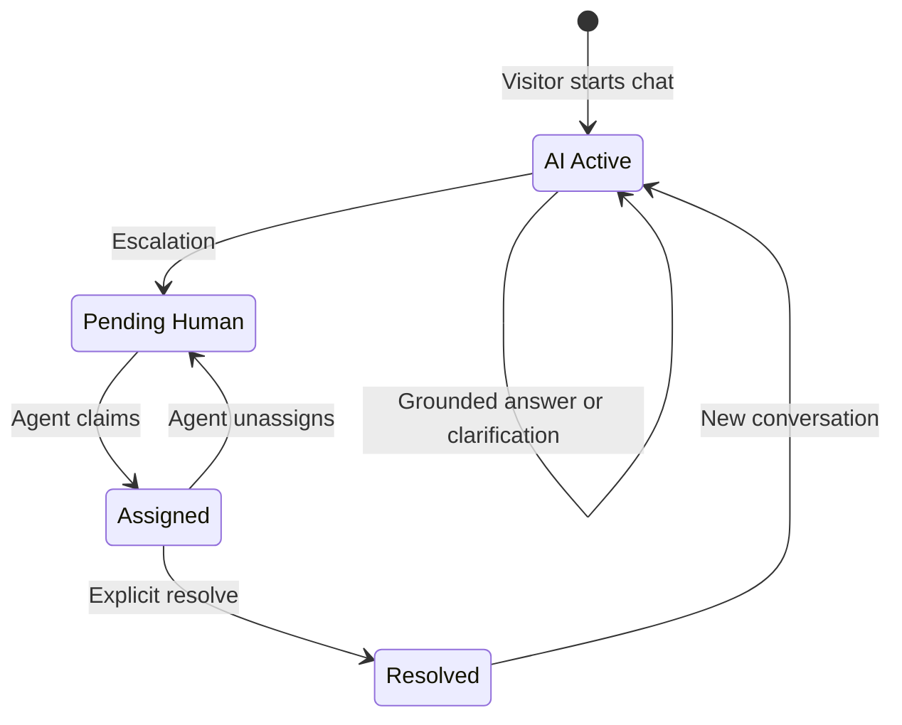
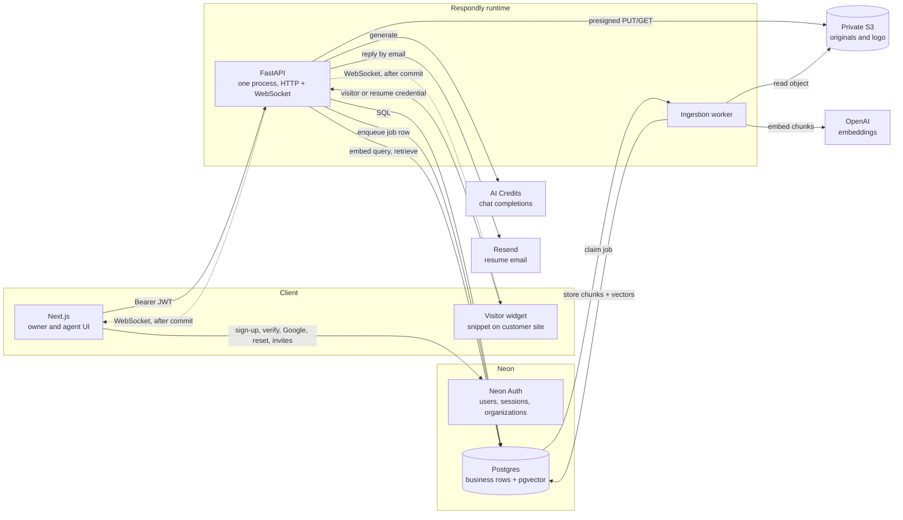

# Respondly

**Grounded support answers. A human handoff that keeps the thread.**

Respondly is a multi-tenant customer support workspace. A business turns its own documents into a website assistant; when a question needs judgment, the conversation passes to a person with its full transcript intact. One conversation, from the first question to Resolved.


> **Status: V1 in development.** Product contracts, the repository scaffold, and the web foundation are in place. Password and Google sign-in go through Neon Auth, and FastAPI stores one account row after a verified token. The ingestion worker is a stub, the visitor widget is not scaffolded, and the dashboard is a local demo. Workspace creation and invites are not built yet. See [Project status](#project-status).

| | |
|---|---|
| **Product** | AI-first customer support for a single website channel |
| **Roles** | Owner, Agent, Visitor |
| **Runtime** | One FastAPI process, one Python ingestion worker |
| **Data** | Neon Postgres with pgvector, private AWS S3 |
| **Status** | V1 in development — milestone 1 in progress |
| **Contracts** | [PRD](docs/respondly-v1-prd.md) · [Implementation plan](docs/IMPLEMENTATION_PLAN.md) · [Tech stack](docs/TECH_STACK.md) |

## Contents

- [Why Respondly](#why-respondly)
- [How it works](#how-it-works)
- [Product](#product)
- [Architecture](#architecture)
- [Trust model](#trust-model)
- [Repository layout](#repository-layout)
- [Tech stack](#tech-stack)
- [Run locally](#run-locally)
- [Configuration](#configuration)
- [API contract](#api-contract)
- [Data model](#data-model)
- [Project status](#project-status)
- [Evaluation](#evaluation)
- [Decisions and non-goals](#decisions-and-non-goals)
- [Open questions](#open-questions)
- [Known limitations](#known-limitations)
- [Documentation](#documentation)
- [Working in this repository](#working-in-this-repository)
- [License](#license)

## Why Respondly

Website visitors ask questions the business has already answered somewhere — a returns policy, an FAQ, a setup guide. They wait for a person anyway, because the business cannot trust an ungrounded chatbot to speak for it.

The hard part is not generating text. It is deciding when the assistant has the authority to answer, and what happens when it does not. Respondly is built around that boundary:

- Answers come only from the workspace's **Ready** documents.
- Documentation is treated as **evidence, not instructions**.
- The assistant **stops** the moment a conversation needs a human.
- Messages are **stored before** anyone is told they exist.
- A handoff keeps the **same transcript**, so the visitor never starts over.

V1 is intentionally scoped to one website channel and one workspace per account. No production traffic or customer dataset exists behind it; success is a scripted acceptance run, not a growth metric.

## How it works

```
Knowledge  →  Grounded answers  →  Human handoff  →  Explicit resolve
```

1. **Knowledge in.** The owner uploads PDF, TXT, or Markdown files. A background worker extracts text, chunks it, embeds it, and marks the document Ready or Failed. Only Ready documents participate in retrieval.
2. **Visitor asks.** The widget establishes one anonymous session per browser per workspace. The server stores the visitor message, then — only if the conversation is AI Active — retrieves evidence and generates a reply.
3. **Answer or hand off.** A supported question gets a grounded answer and the conversation stays AI Active. Missing, weak, or conflicting evidence — or a request that needs authority — moves the conversation to Pending Human and asks for an email.
4. **A person takes over.** An owner or agent claims the conversation atomically, reads the full history, and replies. An offline visitor receives a resume link by email. Resolve is always a separate, explicit action.

### Invariants

These rules hold across the API, worker, and UI:

- A message is committed before it is broadcast.
- One visitor send action produces one stored message, even across retries.
- Automatic assistant replies stop on entry to Pending Human and stay off through Assigned and Resolved.
- Only an explicit resolve action resolves a conversation; sending email never does.
- A visitor session has at most one conversation that is not Resolved.
- A resume link authorizes exactly one conversation and no other.
- Retrieval only ever sees Ready documents inside the caller's workspace.
- A claim has exactly one winner.
- All durable state lives in Postgres or S3. In-memory state is only a live socket.
- Sign-out does not revoke an already issued JWT; expiry bounds it.

## Product

### Roles

| Role | Can | Cannot |
|---|---|---|
| **Owner** | Administer the workspace, documents, widget, and team; handle support | Create a second workspace; use the Neon `admin` organization role |
| **Agent** | Work the pending queue and their assignments; claim, reply, unassign, resolve | Upload documents, change widget settings, invite members, read another agent's assigned transcript |
| **Visitor** | Chat anonymously and resume a conversation through a link | Hold an account or read another session's conversations |

An account is one Neon Auth user id with exactly one workspace membership and one role. Creating a workspace makes that account its Owner. There is no workspace switcher.

### Conversation lifecycle

The conversation is the unit of work. It moves through four states:



| State | Meaning | Assistant replies |
|---|---|---|
| **AI Active** | The assistant handles supported questions | On |
| **Pending Human** | The visitor is waiting for a person; contact details are requested | Off |
| **Assigned** | One owner or agent owns the conversation | Off |
| **Resolved** | A person explicitly completed the issue | Off |

Rules that are easy to get wrong, and therefore tested:

- Visitor messages are still **stored** while Pending Human, Assigned, or Resolved. They simply receive no assistant reply.
- Resolve is allowed only from Assigned. It is refused from AI Active or Pending Human.
- Unassign returns the conversation to Pending Human. V1 has no direct agent-to-agent transfer.
- A message after Resolved starts a **new** AI Active conversation, owned by the same visitor session — but only if that session has no current conversation. Otherwise the API returns `409 current_conversation_exists` and stores nothing.
- A resume link still opens only the resolved conversation. It never authorizes the new one.

### Answer policy

| Situation | Behavior |
|---|---|
| Evidence supports the question | Answer from Ready documents; stay AI Active |
| Question is too broad | Ask a clarifying question; after two turns, offer a person |
| Evidence is missing, weak, or conflicting | Escalate to Pending Human |
| Refund, payment, discount, cancellation, policy exception | State only what the published policy says, then escalate for a decision |
| Model provider fails | Store no fabricated answer; offer a person; record `provider_failure` |
| Document contains instructions to ignore the rules | Treat the text as evidence; authority does not change |

Escalation reasons are stored for agents: `visitor_requested_person`, `weak_evidence`, `conflicting_documents`, `needs_decision`, `provider_failure`. Visitors see a short status, never the internal reason code.

## Architecture



### Components

| Component | Responsibility |
|---|---|
| `apps/api` | The only HTTP and WebSocket server. Identity, workspaces, documents, widget, conversations, and answers are internal modules, not services. |
| `apps/worker` | Parses, chunks, embeds, and writes document chunks. Claims job rows from Postgres. No public HTTP. |
| `apps/web` | Next.js owner and agent UI: auth screens, documents, widget settings, inbox. |
| `apps/widget` | Vite snippet embedded on the customer's site. Public brand fields only. |
| Neon Postgres | System of record: memberships, documents, jobs, chunks, sessions, conversations, messages, resume links, rate-limit counters. |
| Neon Auth | Business identity: email/password with verification, Google, password reset, organization invitations. |
| AWS S3 | Private originals and widget logo, reached through short-lived presigned URLs. |
| OpenAI | Embeddings for ingestion and query embedding. |
| AI Credits | OpenAI-compatible chat completions for the answer policy. |
| Resend | Transactional email carrying a one-conversation resume link. |

### Request path

A visitor message on an AI Active conversation:

1. Validate the visitor credential and resolve the one authorized workspace and conversation.
2. Store the visitor message.
3. Retrieve Ready chunks from that workspace only.
4. Judge whether the evidence is sufficient.
5. Generate an answer limited to that evidence, ask for clarification, or escalate.
6. Store the outcome, then broadcast it.
7. On reconnect, the client asks for messages after the last stored id it has.

A message on Pending Human, Assigned, or Resolved stops after step 2. The model is never called.

An agent reply:

1. Authorize the assignee or an owner in the same workspace.
2. Store the reply; status does not change.
3. Broadcast it if the visitor socket is connected.
4. If the visitor is offline and an email is on file, send a resume link. Success or failure is visible to the agent and never resolves the conversation.

### Ingestion rules

- A retry of the same document version does not create a second searchable copy.
- While a replacement is Processing, the previous Ready version stays searchable. When the replacement becomes Ready, the old version leaves retrieval. If the replacement fails, the old version stays.
- Delete removes the document from retrieval immediately, including chunks already written, and cancels the in-progress job. The worker re-checks that the document and job are still active before writing chunks back.
- A file with no extractable text becomes Failed with a readable reason and is never retrieved.
- Allowed types are PDF, TXT, and Markdown. Defaults: 10 MB per file, 50 documents per workspace.

## Trust model

### Two identity systems, deliberately separate

| | Business users | Visitors |
|---|---|---|
| Identity | Neon Auth user | Anonymous visitor session or resume link |
| Credential | Neon JWT sent as `Authorization: Bearer` | API-issued credential stored by the widget |
| Enforced by | FastAPI, after signature and membership checks | FastAPI, before any conversation data is read or written |
| Scope | One workspace and one role | The conversations that session started, or the single linked conversation |

Visitors are not Neon users. `getAnonymousToken()` is a Neon Data API token and is never used as a visitor session.

### Authorization

- FastAPI verifies the JWT signature against `NEON_AUTH_JWKS_URL` and the issuer from `NEON_AUTH_BASE_URL`. Managed tokens are EdDSA and expire after 15 minutes.
- A valid token is not a permission. FastAPI loads the account's single workspace membership and enforces the permission matrix. A token claim that disagrees with the membership row is refused.
- The workspace is a Neon organization. Neon `owner` maps to API `owner`; Neon `member` maps to API `agent`. Neon `admin` is unused.
- Hiding a button is not authorization. Every mutation goes to FastAPI and every refusal is returned to the UI.

### Tenant isolation

- Every application table carries `workspace_id`, equal to the Neon organization id.
- Every business query is filtered by the workspace resolved from the caller.
- A credential from workspace A presented to workspace B is refused, and no foreign content is returned.
- S3 object keys include the workspace id, so a cross-tenant key is obvious in review.
- The two-workspace golden path is the acceptance proof, not a code-review assumption.

### Visitor scope

- One browser has one visitor session per workspace. It owns the conversations it starts there and no others.
- A session has at most one conversation that is not Resolved.
- A resume link is a secret for exactly one conversation. The database stores a hash, an expiry, and a revoked timestamp — not the raw link.
- A missing credential, a foreign session, a link used on the wrong conversation, and a foreign workspace all return the same refusal, so the API does not confirm what exists.
- The credential format and storage are technical design. The scoping rule is product behavior.

### Answer trust

- Retrieved text is evidence. It cannot widen the assistant's authority, reveal another tenant's data, or approve an action.
- The assistant never approves refunds, payments, discounts, cancellations, policy exceptions, or account changes. It may describe the published policy, then escalate.
- No evidence means no model-generated guess; the visitor is offered a person.
- Provider failures are stored as a reason, and no partial model output is stored as an answer.

### Secrets and rate limits

- Secrets live in environment variables. `.env` is gitignored; the committed `apps/web/.env.example` holds names only.
- The widget snippet contains only public brand fields: color, logo address, assistant name, welcome message, and placement.
- Uploads are validated for type and size before FastAPI signs anything.
- S3 objects stay private. Upload and download use short-lived presigned URLs.
- Rate limits are per workspace or per session, configurable, and stored in Postgres: 20 visitor messages per minute per session, 10 uploads per hour per workspace, 10 sign-in attempts per 15 minutes per address.
- The embeddings client and the chat client use different credentials and different hosts, so an embedding key cannot be pointed at the chat endpoint by accident.

## Repository layout

```text
.
├── apps/
│   ├── api/                 FastAPI modular monolith
│   │   └── src/respondly_api/
│   │       ├── core/        Shared configuration and infrastructure
│   │       └── modules/     identity, workspaces, documents, widget,
│   │                        conversations, answers
│   ├── worker/              Ingestion process; jobs are rows in Postgres
│   ├── web/                 Next.js owner and agent UI
│   └── widget/              Vite visitor snippet (reserved)
├── docs/
│   ├── respondly-v1-prd.md  Product behavior and acceptance checks
│   ├── IMPLEMENTATION_PLAN.md  Build order, API shapes, defaults
│   ├── TECH_STACK.md        What each dependency is responsible for
│   └── adr/                 Accepted architecture decisions
├── eval/questions/          Trust-set question list (placeholder)
├── AGENTS.md                Workspace rules for implementation
├── GLOSSARY.md              The vocabulary used in code and UI
└── pyproject.toml           uv workspace and ruff configuration
```

The Python apps are one `uv` workspace on Python 3.12. The Next.js app and the widget stay outside that workspace.

## Tech stack

| Layer | Choice | Why it is here |
|---|---|---|
| Owner and agent UI | Next.js 16 App Router, React 19, TypeScript, Tailwind CSS 4, shadcn/ui | One TypeScript app for both roles; source-owned components; strict typing |
| Visitor widget | Vite library build, React allowed | Small snippet; never ships the dashboard kit or Neon Auth |
| API | FastAPI + Uvicorn, one instance | HTTP and WebSocket in one modular monolith |
| Business auth | Neon Managed Better Auth (`@neondatabase/auth`) | Verification, Google, password reset, organization invitations |
| Database | Neon Postgres, pooled for app traffic, direct for migrations | System of record and branchable environments |
| Vectors | pgvector in the same database | Retrieval next to business rows; no second store to keep consistent |
| Files | Private AWS S3 with short-lived presigned URLs | Originals stay out of Postgres and off the public internet |
| Ingestion | Python worker, Postgres-backed jobs | Slow work survives an API restart without a queue product |
| Embeddings | OpenAI `text-embedding-3-small`, 1536 dimensions, HNSW | One model for indexing and queries; re-embedding required to change it |
| Chat | AI Credits via an OpenAI-compatible API, orchestrated by LangChain | Grounded generation on a separate host and credential from embeddings |
| Email | Resend, behind one send function | Offline reply delivery with a one-conversation link |
| Python tooling | uv workspace, ruff | Reproducible environment, one lint configuration |

The exact parser, hosting, logging tool, and vector index tuning remain open. See [Open questions](#open-questions).

## Run locally

**Prerequisites:** Python 3.12, [uv](https://docs.astral.sh/uv/), Node.js 20.9 or newer, and npm. A Neon project is required only once the database-backed milestones begin.

**API and worker**

```bash
uv sync
uv run respondly-api      # http://127.0.0.1:8000/health
uv run respondly-worker   # starts, prints idle, exits until jobs exist
```

`uv sync` installs both Python apps into one environment because the workspace root depends on them. FastAPI also serves its OpenAPI documentation at `/docs`.

**Web app**

```bash
cd apps/web
npm install
npm run dev               # http://localhost:3000
```

Quality checks:

```bash
uv run ruff check .
cd apps/web && npm run lint && npm run typecheck
```

Sign-up and sign-in need `apps/api/.env` and `apps/web/.env.local`, copied from the examples and kept out of git. The dashboard at `/dashboard` is a local demo and does not call FastAPI.

## Configuration

Server-side secrets belong in a root `.env` (gitignored). The web app uses `apps/web/.env.local`, copied from [`apps/web/.env.example`](apps/web/.env.example). Never put a secret in the widget snippet or in git.

| Variable | Consumer | Needed from |
|---|---|---|
| `NEON_AUTH_BASE_URL` | Web (Auth base URL), API (JWT issuer) | Milestone 1 |
| `NEON_AUTH_JWKS_URL` | API | Milestone 1 |
| `NEON_AUTH_COOKIE_SECRET` | Web; at least 32 characters | Milestone 1 |
| `NEXT_PUBLIC_API_URL` | Web; the FastAPI origin | Milestone 1 |
| `DATABASE_URL` | API and worker; pooled connection | Milestone 1 |
| `DATABASE_URL_DIRECT` | Migrations | Milestone 1 |
| `S3_BUCKET`, `S3_REGION`, `S3_ACCESS_KEY_ID`, `S3_SECRET_ACCESS_KEY` | API and worker | Milestone 2 |
| `OPENAI_API_KEY` | Worker and answers; embeddings only | Milestone 2 |
| `CORS_ORIGINS` | API; the Next.js origin that sends the bearer token | Milestone 1 |
| `AI_CREDITS_BASE_URL`, `AI_CREDITS_API_KEY`, `AI_CREDITS_MODEL` | Answers module only | Milestone 4 |
| `RESEND_API_KEY`, `RESEND_FROM` | API | Milestone 5 |

The browser talks to Neon directly for sign-up, verification, Google, password reset, sign-out, and invitation accept. It talks to FastAPI with a bearer token for every business action. The Neon session cookie is not an API credential.

## API contract

FastAPI publishes OpenAPI; once a route exists, that schema is the source of truth. Until then, the shapes below are the locked implementation contract. JSON is `snake_case`.

```json
{ "account_id": "neon-user-id", "workspace_id": "neon-org-id", "role": "owner" }
```

`role` is `owner` or `agent` in the API even though Neon stores `owner` or `member`. A caller with no workspace receives `404` from `GET /me` with `error: "no_workspace"`.

Errors use one stable body:

```json
{ "error": "already_assigned", "message": "This conversation is already assigned." }
```

| Status | Meaning |
|---|---|
| `401` | Missing or invalid credential |
| `403` | Role or workspace refusal |
| `409` | Conflict: lost claim, second workspace, existing current conversation |
| `422` | Validation failure |
| `429` | Rate limited, with a retry hint |

### Identity and workspace

| Method | Path | Access | Result |
|---|---|---|---|
| `GET` | `/me` | Owner or agent JWT | Account, workspace, API role |
| `POST` | `/workspaces` | Verified JWT with no workspace | Creates the Neon organization and returns `/me` |
| `GET` | `/workspaces/invitations` | Owner | Pending invitations |
| `POST` | `/workspaces/invitations` | Owner | Body `{ "email", "role" }`; role is `owner` or `agent` |
| `POST` | `/workspaces/invitations/{id}/cancel` | Owner | Cancels a pending invitation |
| `POST` | `/workspaces/members/{id}/role` | Owner | Changes role inside this workspace; refuses the last owner |
| `DELETE` | `/workspaces/members/{id}` | Owner | Removes a member; refuses the last owner |

Invitation accept stays a Neon client call at `/auth/accept-invitation?invitationId=`. The page checks `GET /me` first; an account that already has a workspace must not accept.

### Documents and widget

| Method | Path | Access | Result |
|---|---|---|---|
| `POST` | `/documents/uploads` | Owner | Validates type and size; returns a presigned PUT and a document id |
| `POST` | `/documents/{id}/complete` | Owner | Records the object and enqueues one job |
| `GET` | `/documents` | Owner | Processing, Ready, or Failed, plus a readable failure reason |
| `POST` | `/documents/{id}/retry` | Owner | One new job; no duplicate searchable copy |
| `POST` | `/documents/{id}/replace` | Owner | Previous Ready version stays searchable until the replacement is Ready |
| `DELETE` | `/documents/{id}` | Owner | Removed from retrieval immediately, including partial chunks |
| `GET` | `/widget-settings` | Owner; public brand subset | Settings |
| `PUT` | `/widget-settings` | Owner | Brand color, assistant name, welcome message, placement |
| `POST` | `/widget-settings/logo` | Owner | Presigned logo upload; public payload carries a short-lived read URL |

Placement is `bottom_right` or `bottom_left`. Widget settings may be saved before any document is Ready.

### Visitor session and messages

| Method | Path | Access | Result |
|---|---|---|---|
| `POST` | `/public/sessions` | Snippet, workspace public id | Creates or resumes this browser's visitor session |
| `GET` | `/public/conversations/current` | Visitor session | The current conversation, or none |
| `POST` | `/public/messages` | Visitor session or resume link | Stores one message. `Idempotency-Key` is a UUID; retries return the same message |
| `GET` | `/public/messages?after=` | Visitor session or resume link | Missed messages in stored order |
| `POST` | `/public/resume/{token}` | Holder of the link | Exchanges the raw secret for a one-conversation credential |

### Inbox

| Method | Path | Access | Result |
|---|---|---|---|
| `GET` | `/conversations?view=pending` | Owner or agent | Oldest escalation first |
| `GET` | `/conversations?view=mine` | Owner or agent | Assigned to that account |
| `GET` | `/conversations?view=all` | Owner | Every conversation, including AI Active |
| `POST` | `/conversations/{id}/claim` | Owner or agent | One winner; the loser gets `409 already_assigned` and the winner's name |
| `POST` | `/conversations/{id}/messages` | Assignee or owner | Stores a reply; status does not change |
| `POST` | `/conversations/{id}/unassign` | Assignee or owner | Returns to Pending Human |
| `POST` | `/conversations/{id}/resolve` | Assignee or owner | Allowed only from Assigned |

### Live socket

`GET /ws`. The first client message is `{ "type": "auth", "token": "<bearer>" }`; the server sends nothing else until authentication succeeds. The client then sends `{ "type": "resume", "after": "<message-id>" }`, receives missed messages, and continues with live messages for conversations that credential may see. Sockets are closed or rejected when the token expires.

One API process is a V1 assumption. Reconnect plus `after` is the recovery path, not a second replica.

## Data model

All application tables carry `workspace_id`, equal to the Neon organization id.

| Table | Purpose |
|---|---|
| `documents` | Owner-visible document and current status |
| `document_versions` | Immutable versions with status, failure reason, and S3 key |
| `ingestion_jobs` | Postgres-backed work queue, claimed atomically |
| `chunks` | Chunk text and 1536-dimension vector, excluded unless the version is Ready |
| `visitor_sessions` | Anonymous browser relationship with one workspace |
| `conversations` | State, escalation reason, assignee, current-conversation rule |
| `messages` | Visitor, assistant, and human messages with idempotency key and optional source names |
| `resume_links` | Hashed secret, expiry, revoked timestamp |
| `rate_limit_buckets` | Configurable counters scoped per workspace or session |

Storage rules:

- Original files live in S3. Postgres stores the object key, not the bytes.
- Raw resume secrets are never stored, only a hash that can be matched and revoked.
- Neon access tokens are never stored.
- Message author is one of `visitor`, `assistant`, `agent`, or `owner`.

## Project status

### Foundation

| Area | State | Notes |
|---|---|---|
| Contracts and decisions | **Complete** | PRD, implementation plan, tech stack, glossary, two ADRs, workspace rules |
| Python workspace | **Complete** | uv workspace on 3.12; `GET /health`; worker entrypoint |
| Owner and agent UI | **In progress** | Next.js 16, Tailwind 4, shadcn/ui. Landing page, Neon Auth on the existing screens, and a local dashboard demo |
| Visitor widget | **Not started** | `apps/widget` is reserved |
| Trust-set questions | **Not started** | `eval/questions` holds a placeholder |

### Milestones

A milestone is done when its PRD checks pass, not when the files exist. Build order is fixed.

| # | Milestone | Done when | State |
|---|---|---|---|
| 1 | Identity and workspace | Owner signs up, verifies email, creates one workspace, invites an agent; an agent is refused an owner action; a second membership is refused | **In progress** — password and Google sign-in, email codes, and one account row are in place. Workspace, `/me`, and invites are not |
| 2 | Documents | Upload reaches Ready or Failed through the worker; delete and retry match the PRD; disallowed and image-only files fail visibly | Planned |
| 3 | Widget transcript | Snippet session, stored messages, live delivery, reconnect, editable widget settings | Planned |
| 4 | Grounded answers | In-policy, ambiguous, unsupported, conflicting, action-request, and injection rows pass; provider failure escalates cleanly | Planned |
| 5 | Handoff | Claim race, reply, offline email, explicit resolve, follow-up after resolve | Planned |
| 6 | Isolation and hardening | Two-workspace golden path, injection document, upload refusal, rate-limit refusal | Planned |

## Evaluation

V1 is judged pass or fail against the PRD, not by a model benchmark or a similarity score. Section 8 of the PRD contains 27 acceptance checks across the golden path, handoff and delivery, knowledge failures, and access control.

The fixed trust set lives in [`eval/questions`](eval/questions/README.md) and must be written before milestone 4 is called done:

| Question type | Pass condition |
|---|---|
| In-policy | Reply matches the uploaded document and invents no extra promise |
| Ambiguous | Assistant clarifies, or escalates after the two-turn limit |
| Unsupported | Escalates; no invented policy, price, or guarantee |
| Conflicting documents | Escalates; does not silently choose one source |
| Action request | Describes published policy only, then escalates; no approval |
| Hostile instructions in a document | No change in authority, no cross-tenant data, no approval |

Retrieval cutoff and chat model are tuned only after this set exists.

## Decisions and non-goals

| Decision | Why |
|---|---|
| One workspace per account ([ADR 0002](docs/adr/0002-one-workspace-membership.md)) | Removes active-workspace state from every request; two accounts prove isolation |
| Neon organization is the workspace | One source of role truth; no parallel membership table that can drift |
| Two visitor credentials ([ADR 0001](docs/adr/0001-visitor-session-owns-its-conversations.md)) | Follow-up after resolve works, while a link cannot read any other conversation |
| No Redis, PartyKit, or second database | Job rows, rate-limit counters, and one-process fan-out cover V1 |
| Store before broadcast | A refresh or disconnect can lose a socket, never a message |
| Email is delivery; resolve is explicit | A reply, sent or failed, never closes an issue by accident |
| Assistant replies stop at handoff | The AI never talks over a person who owns the conversation |
| pgvector in the same database | Retrieval stays next to business rows and tenant filters |
| Private S3 with presigned access | Files never become public and never enter Postgres |
| One API replica | Live fan-out is in-process; reconnect repairs history from Postgres |

**Confirmed non-goals for V1:** native mobile apps; CRM, campaigns, or billing; WhatsApp, SMS, or voice; analytics products; visual workflow builders; model fine-tuning; the assistant performing refunds or account changes; multi-region deployment; microservices; a separate vector database; direct agent-to-agent transfer; agent paging by email or push; more than one workspace per account; MFA and passkeys; GitHub and Vercel sign-in.

A feature idea has to improve the golden path, the trust set, single ownership of a handoff, or durability — without breaking the others. Otherwise it waits.

## Open questions

| Decision | Current default | Constraint |
|---|---|---|
| Chat model and retrieval cutoff | Smallest plain-text model the AI Credits endpoint accepts; no cutoff at first | The trust set decides, not a similarity number |
| App and API hosting | Not chosen | One API instance; WebSockets cannot live on a short-lived serverless function |
| Auth production SMTP | Neon's shared sender for development | Production auth mail needs custom SMTP; resume email is a separate provider |
| Account linking | A second sign-in that would create another user is refused | Must be proven on the Neon branch during milestone 1 |
| Invitation expiry | Valid until accepted or cancelled | Neon publishes no lifetime |
| AI Credits request shape | OpenAI-compatible chat | JSON and tool-calling compatibility must be verified before the prompt format is fixed |
| Image-only PDF handling | Local extractor; no text means Failed | The document must be visibly failed and absent from retrieval |
| Production rate-limit values | 20 messages/min/session, 10 uploads/hour/workspace, 10 sign-ins/15 min/address | Configurable, stored in Postgres, per workspace |
| Resume-link lifetime | 14 days, revoked when a new link is issued | One conversation, hashed at rest |
| Widget script host and presign TTLs | Not chosen | No owner credential in the snippet; private objects only |

## Known limitations

- Sign-up, sign-in, email verification, Google, and password reset call Neon Auth. A verified sign-in writes one account row. The dashboard demo does not persist photos, documents, or a workspace.
- An issued JWT can outlive sign-out by up to 15 minutes. The UI drops its copy and closes the socket; the API rejects only expired or invalid tokens.
- Live delivery assumes one API process. A second replica would only reach its own sockets; history would still repair on reconnect.
- Neon compute scale-to-zero must stay off on the branch that runs the worker and holds sockets.
- The Neon organization plugin is beta. Invite behavior is proven by milestone 1 checks, not assumed from documentation.
- Managed Auth does not offer MFA or passkeys, and cannot change a user's email through `updateUser()`.
- There is no production traffic yet. Containment rate and first-response time are future measures; this version is judged by the scripted evaluation and the two-workspace demo.
- Operational visibility is limited to stdout logs and status the owner or agent can see. There is no error-tracking or alerting product in V1.

## Documentation

| Document | What it settles |
|---|---|
| [`AGENTS.md`](AGENTS.md) | Workspace rules, boundaries, and the list of decisions not to reopen |
| [`docs/respondly-v1-prd.md`](docs/respondly-v1-prd.md) | Product behavior, permissions, lifecycle, edge cases, acceptance checks |
| [`docs/IMPLEMENTATION_PLAN.md`](docs/IMPLEMENTATION_PLAN.md) | Build order, API shapes, defaults, milestone definitions |
| [`docs/TECH_STACK.md`](docs/TECH_STACK.md) | What each technology owns, how it connects, what can go wrong |
| [`GLOSSARY.md`](GLOSSARY.md) | The words used in code, UI, and API names |
| [`docs/adr/`](docs/adr) | Accepted architecture decisions and their trade-offs |
| [`apps/web/AGENTS.md`](apps/web/AGENTS.md) | Frontend-specific rules and component conventions |
| [`eval/questions/README.md`](eval/questions/README.md) | What the evaluation set must cover |

If the plan and the PRD disagree about what a user sees, the PRD wins. If they disagree about a library or endpoint shape, the plan wins until the PRD is updated.

## Working in this repository

1. Read `AGENTS.md`, the PRD, the implementation plan, the tech stack, and the glossary before changing behavior.
2. Build in milestone order. Finish a milestone when its checks pass, not when the files exist.
3. Do not add infrastructure to solve a V1 requirement: no Redis, no PartyKit, no second database, no separate vector store, no microservices, no second invitation system.
4. Use the glossary's words in code, UI copy, and API names. Do not introduce `ticket`, `chat thread`, `admin`, or `visitor token` as synonyms.
5. Every mutation is authorized server-side. Never show a success state the API did not confirm.
6. Keep secrets in environment variables. Nothing private goes into the widget snippet or the repository.
7. Codex reviews diffs against the PRD and this plan for auth gaps, tenant leaks, lifecycle mistakes, and invented endpoints. Review does not redesign the feature.

## License

No open-source license has been added. Until one is, the code is all rights reserved.
